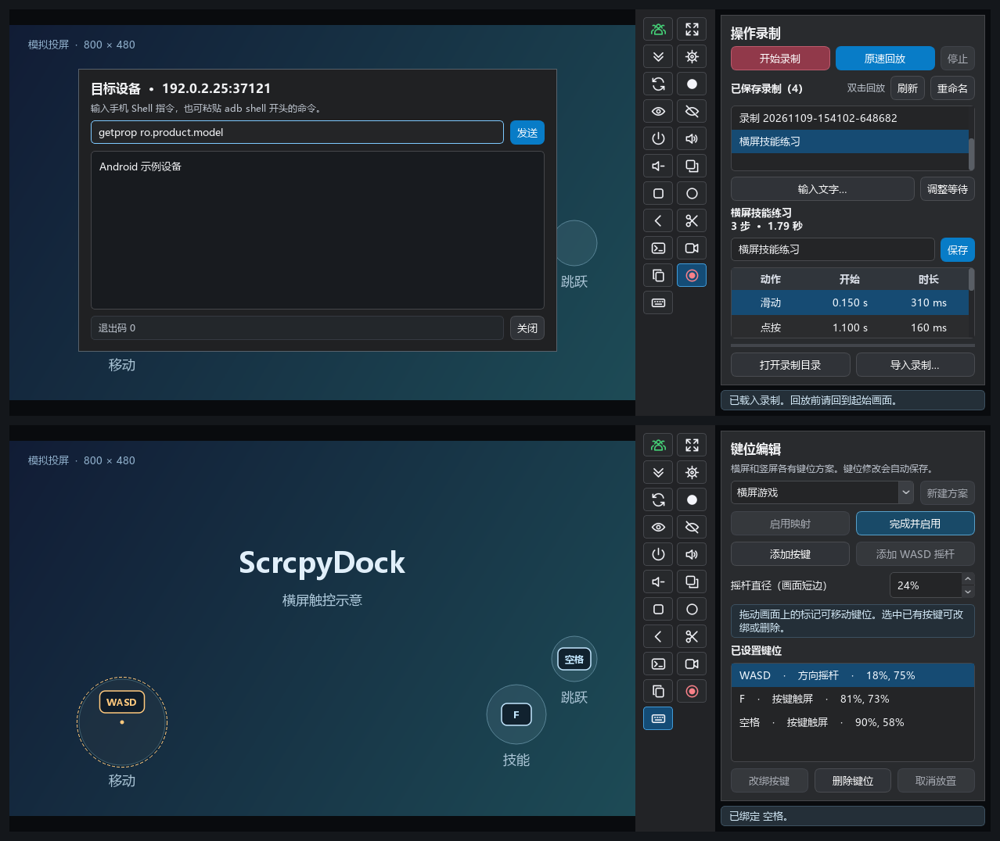

# ScrcpyDock

[简体中文](README.md) · English

ScrcpyDock is a Windows app for mirroring and controlling Android devices over USB or Wi-Fi. Record and replay test actions, or map keyboard keys to on-screen controls.



## Features

- Open devices in separate windows, start mirroring in batches, and control multiple devices together.
- Save PNG screenshots and MP4 screen recordings. Recordings split automatically when the video dimensions change.
- Record taps, swipes, text, and delays. Name recordings, edit delays, and replay saved sequences.
- Map keys to touch positions and configure a resizable WASD joystick. Portrait and landscape mappings are saved separately.
- Run ADB shell commands on the selected device. Audio forwarding is supported on Android 11 and later.

## Quick start

Download the Windows x64 portable preview, extract the whole archive, and launch `ScrcpyDock.exe`. Enable USB debugging on your phone, approve the computer when prompted, and double-click the device in ScrcpyDock. [Portable download](https://gitee.com/yugengitee/scrcpydock/releases/tag/v0.1.0-beta.1)

### Run from source

Install 64-bit Python 3.11–3.14 and add Android SDK Platform-Tools to PATH. Run these commands from the repository root, then double-click `启动ScrcpyDock.cmd`. [Platform-Tools download](https://developer.android.com/tools/releases/platform-tools)

```powershell
python -m pip install -r requirements.txt
adb version
```

For Wi-Fi, pair using the code shown on the phone. Then connect using the IP address and connection port on the main Wireless debugging screen. [Android wireless debugging guide](https://developer.android.com/tools/adb#wireless)

## Controls and saved files

- **F9** starts or stops action recording. **F10** plays the current recording. **Esc** stops playback. Return the phone to the original starting screen before replaying.
- Use the keyboard icon to edit touch mappings or add a WASD joystick.
- Use the camera icon to record video and the terminal icon to run ADB commands.
- The local `data/` folder stores settings and mappings, screenshots and videos in `截图/`, and action recordings in `录制/`.

## Testing and credits

Wi-Fi mirroring, touch indicators, and audio reception were tested on a physical device. Video decoding, action playback, key mapping, and ADB routing were tested with mocks. In-game mappings, Chinese text paste, and USB mirroring on a clean Windows PC still need hands-on testing.

The desktop app uses Python, PySide6, and PyAV. The interface takes inspiration from QtScrcpy and uses the bundled scrcpy 3.3.4 server for mirroring. [QtScrcpy](https://github.com/barry-ran/QtScrcpy) · [scrcpy 3.3.4](https://github.com/Genymobile/scrcpy/releases/tag/v3.3.4) · [Server license](vendor/LICENSE-scrcpy.txt)

## License

[Apache License 2.0](LICENSE)
