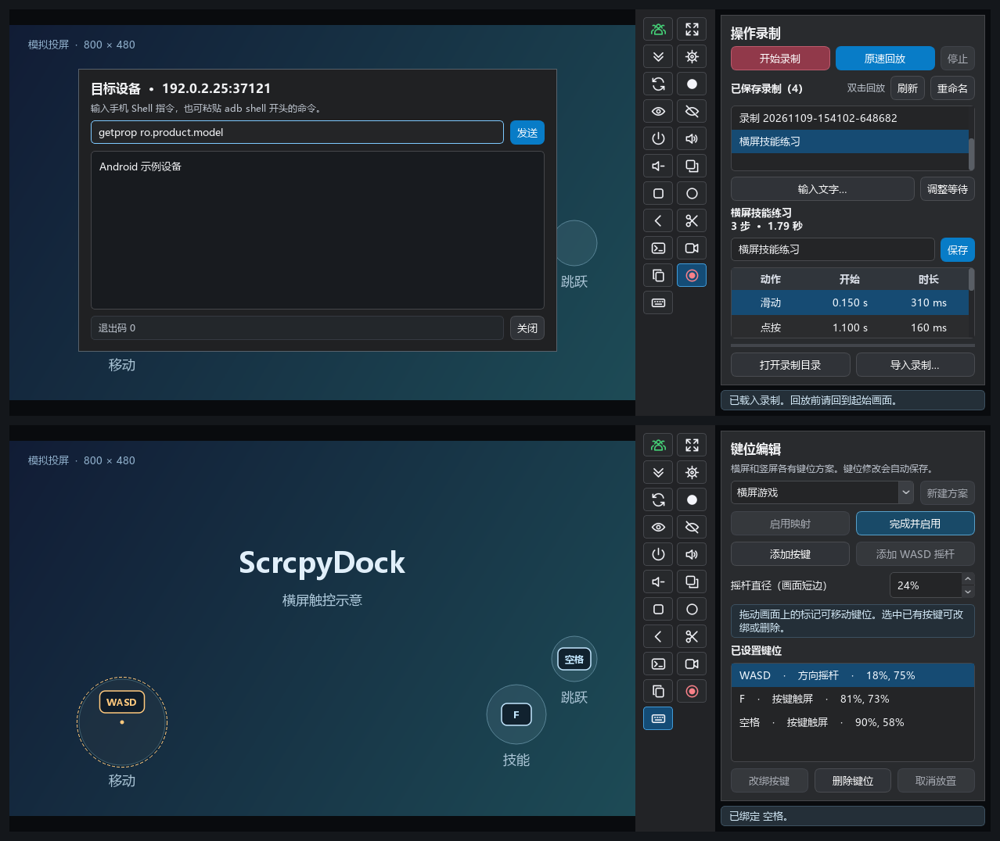
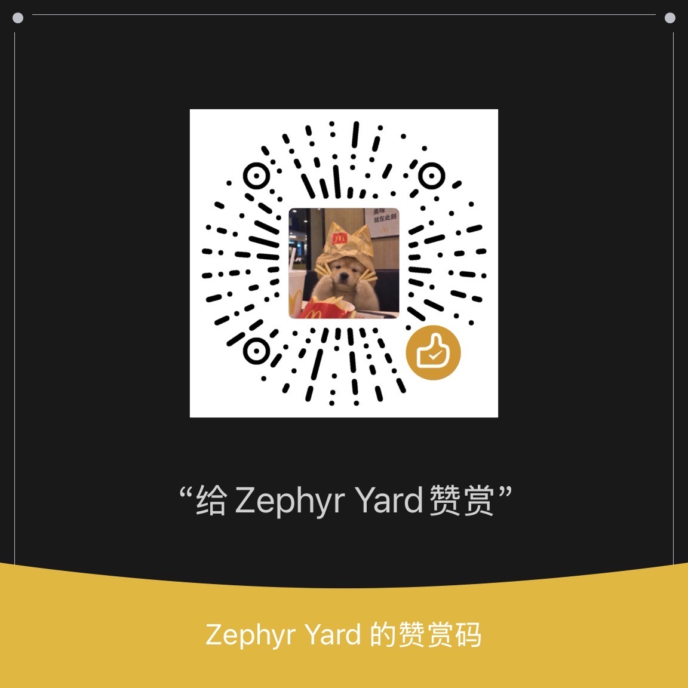

# ScrcpyDock

简体中文 · [English](README.en.md)

Windows 上的 Android 投屏与操作工具。通过 USB 或 Wi-Fi 控制手机，录下测试操作并回放，或把游戏触点绑定到键盘。



## 功能

| 功能 | 操作与结果 |
| --- | --- |
| USB / Wi-Fi 投屏 | 双击设备打开独立窗口。支持批量投屏、多机群控和横竖屏工具栏。 |
| 截图与录屏 | 侧栏保存 PNG 和 MP4。录屏时画面尺寸变化会自动分段。 |
| 操作录制与回放 | 记录点按、滑动、文字与等待，可命名、重命名、调整等待和回放。 |
| 游戏键位 | 将键绑定到屏幕位置，支持长按、拖动改位和可调直径的 WASD 摇杆。横竖屏方案分别保存。 |
| ADB Shell 与音频 | 向当前手机发送命令并查看输出、退出码。Android 11 及以上支持音频转发。 |

## 快速开始

Windows x64 用户可下载免安装预览版，完整解压后双击 `ScrcpyDock.exe`。首次 USB 连接需要在手机上开启 USB 调试并授权电脑。 [免安装版下载](https://gitee.com/yugengitee/scrcpydock/releases/tag/v0.1.0-beta.1)

### 从源码运行

1. 安装 64 位 Python 3.11–3.14 和 Android SDK Platform-Tools，将 `platform-tools` 加入 PATH。 [Platform-Tools 下载](https://developer.android.com/tools/releases/platform-tools)
2. 在项目根目录执行以下命令。

```powershell
python -m pip install -r requirements.txt
adb version
```

3. 双击 `启动ScrcpyDock.cmd`。USB 连接时，在手机上开启 USB 调试并授权电脑，再双击设备列表中的手机。
4. 无线连接时，先用手机无线调试页面的配对码完成配对，再用无线调试主页面的 IP 和连接端口连接。 [无线调试说明](https://developer.android.com/tools/adb#wireless)

## 投屏窗口怎么用

- **录屏**。点击摄像机开始，再点红色方块保存 MP4。
- **回放操作**。按 **F9** 开始或结束录制，保存后可在列表双击回放。**F10** 回放当前录制，**Esc** 停止。回放前先把手机切到录制时的起始画面。
- **绑定键位**。打开键盘图标，添加按键或 WASD 摇杆并放到游戏控件上，点「完成并启用」。摇杆直径按画面短边百分比设置，方向键从圆心滑向圈边。
- **发送 ADB 命令**。点终端图标，输入 `getprop ro.product.model` 测试当前设备。

## 文件在哪里

| 路径 | 内容 |
| --- | --- |
| `app/` | Python 源码、主题和界面资源 |
| `vendor/` | 手机端 scrcpy 服务及其许可证 |
| `data/截图/` | PNG 截图和 MP4 录屏 |
| `data/录制/` | 可回放的操作录制 JSON |
| `data/连接设置.ini`、`data/键位方案.json` | 设备与投屏设置、键位方案 |

运行数据默认保存在项目目录，`data/` 已加入 Git 忽略规则。

## 验证与来源

已在 Wi-Fi 真机验证投屏、触点显示和音频数据接收。录屏文件解码、动作回放、键位和 ADB 命令路由通过模拟测试，游戏内键位和中文粘贴待真机验证。

桌面端使用 Python、PySide6 和 PyAV。界面参考 QtScrcpy，投屏使用随附的 scrcpy 3.3.4 手机端服务。 [QtScrcpy](https://github.com/barry-ran/QtScrcpy) · [scrcpy 3.3.4](https://github.com/Genymobile/scrcpy/releases/tag/v3.3.4) · [服务许可证](vendor/LICENSE-scrcpy.txt)

[完整使用说明](使用说明.md)

## 许可证

[Apache License 2.0](LICENSE)

## 支持项目

ScrcpyDock 免费使用，欢迎自愿扫码赞赏。


